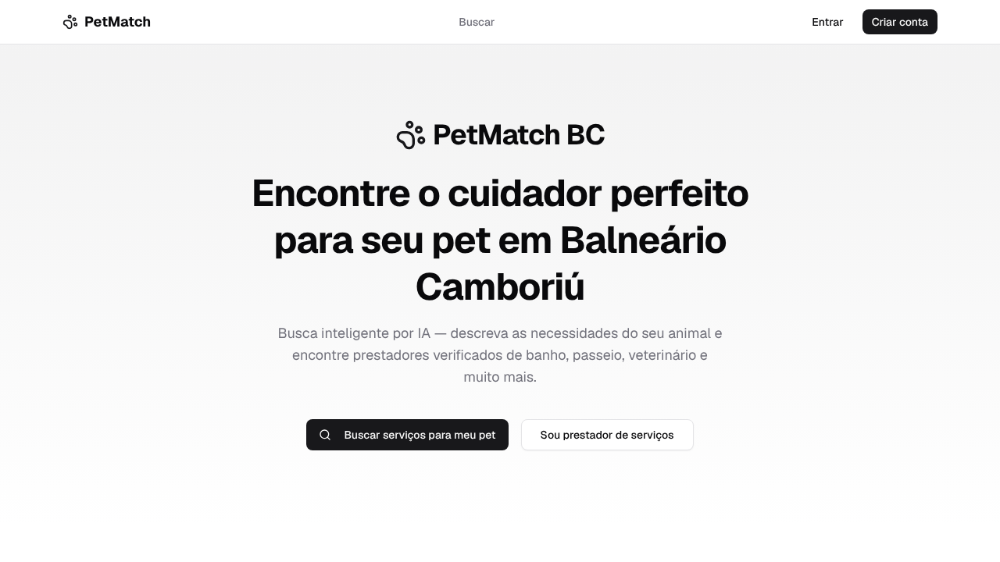
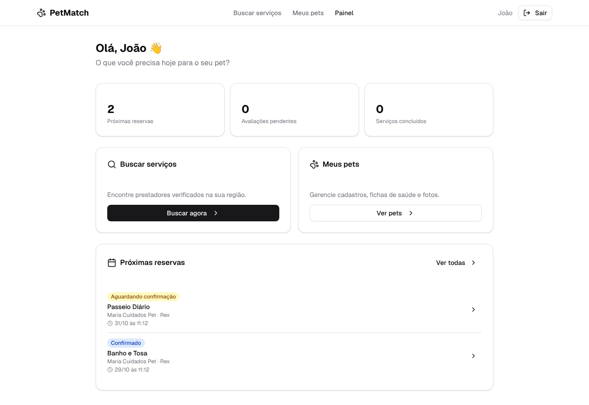
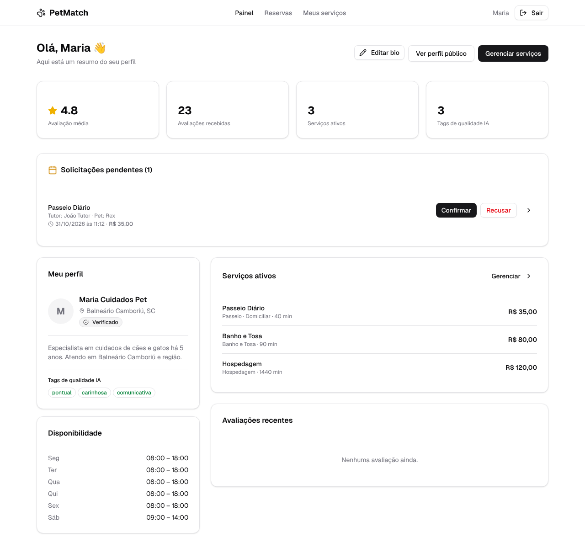
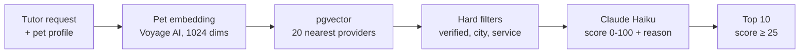

<div align="center">


# PetMatch

**Marketplace for pet services that uses semantic search and an LLM to match each pet with the right provider.**


[](https://github.com/giobroliatto/petmatch/actions/workflows/ci.yml)

</div>

**English** · [Português](README.pt-BR.md)

> [!NOTE]
> PetMatch is built for the Brazilian market, starting with Balneário Camboriú, so the UI, the prompts and the code comments are in Portuguese.



---

## The problem

Finding someone you trust to bathe, walk or look after your pet usually means asking around in group chats. Generic marketplaces filter by category and city, but they don't know that your dog is anxious around strangers, that your cat is 14 and needs medication, or that you'd rather have someone who comes to your home.

## The solution

PetMatch lets the owner (the **tutor**) describe what they need in plain language, for example *"someone patient to walk my senior dog, he pulls on the leash"*. The search combines the pet's profile, the request and each provider's profile to return a ranked list with a short explanation of why each provider fits.

From there, the full service cycle happens inside the app: booking, a chat per booking, an AI-generated briefing for the provider, reminders, and a review afterwards.

## How it works

1. **Tutors** register their pets (species, breed, age, weight, notes and health records with due-date reminders).
2. **Providers** set up a profile with services, prices, weekly availability, a photo gallery and an ID document for verification.
3. An **admin** reviews the document and approves the provider. Only verified providers appear in searches.
4. The tutor searches, books a service and talks to the provider in the booking chat.
5. The provider confirms or rejects the booking. Confirmation e-mails and reminders 24 hours and 2 hours before the service go out automatically.
6. After the service, the tutor leaves a review, which feeds back into the provider's profile.

<table>
<tr>
<td width="50%"><p align="center"><sub>Tutor dashboard</sub></p></td>
<td width="50%"><p align="center"><sub>Provider dashboard, with pending requests and AI quality tags</sub></p></td>
</tr>
</table>

## AI features

### Matching: vector search + LLM reranking



- **Embeddings** for pets and providers are generated with **Voyage AI** and stored in a `vector(1024)` column in PostgreSQL. They are created **asynchronously** through a BullMQ queue whenever a pet or provider profile changes.
- The search orders providers by vector distance with **pgvector** (`<=>`), then applies hard filters (verified, city, service type).
- **Claude Haiku** reranks the remaining candidates. The prompt defines explicit scoring rules (offering the requested service is decisive, matching quality tags and high ratings add points) and asks for a JSON array with a score and a reason in Portuguese for each provider.
- **Every step has a fallback:** no embedding → traditional search by city and rating; empty vector results → traditional search; LLM failure → ranking by rating with a generic reason. The search never breaks because an AI provider is down.

### Pre-service briefing

When a booking is created, Claude turns the pet's data and the tutor's notes into a short structured briefing for the provider (essential info, special care, owner notes). If generation fails, the booking is created without it.

### Quality tags from reviews

Each new review triggers a background job in which Claude reads the provider's reviews and extracts up to six quality tags, such as *"punctual"* or *"great with anxious pets"*. The tags show up on the profile and are used by the matching.

## Features

| Profile | What they can do |
|---|---|
| Tutor | Manage pets and health records, AI search, book services, chat, cancel, review |
| Provider | Profile, services and prices, weekly availability, gallery, verification, confirm/reject/complete bookings, chat |
| Admin | Platform stats, approve or reject verifications, suspend users, integration diagnostics |

## Technical highlights

- **pnpm monorepo** with `apps/web` (Next.js) and `apps/api` (Fastify), plus a `packages/shared` package for Zod schemas and types.
- **Background jobs with BullMQ:** embeddings, review analysis and transactional e-mails (including delayed 24h and 2h reminders) run outside the request cycle.
- **Graceful degradation:** each external integration (Voyage, Anthropic, Cloudflare R2, Resend) is optional in development, and the admin diagnostics page shows which ones are configured.
- **Security:** JWT authentication on the API, role-based route protection on the front end (Next.js proxy), per-route rate limiting backed by Redis, and uploads validated by their actual content (magic bytes), not just the extension.
- **Auth:** e-mail and password or Google sign-in with Auth.js (NextAuth v5), plus password reset by e-mail.
- **Local e-mail testing** with Mailpit: every e-mail the app sends can be inspected at `localhost:8025`.
- **Tests for the matching pipeline** with Vitest, covering every fallback, the hard filters and how Claude's ranking is applied.
- **CI on every push** with GitHub Actions: type checking, tests, linting and production builds for both apps.

## Stack

| Layer | Technologies |
|---|---|
| Front end | Next.js 16 (App Router), React 19, Tailwind CSS 4, shadcn/ui, TanStack Query, React Hook Form, Zod, Auth.js |
| API | Node.js, Fastify 5, Prisma, Zod, JWT, bcrypt |
| Data | PostgreSQL 16 + pgvector, Redis |
| AI | Claude Haiku (Anthropic SDK), Voyage AI embeddings |
| Jobs and e-mail | BullMQ, Resend (production), Nodemailer + Mailpit (development) |
| Storage | Cloudflare R2 (S3-compatible) |
| Tests and CI | Vitest, GitHub Actions |

## Running locally

Requirements: Node.js 20+, pnpm 9+ and Docker.

```bash
git clone https://github.com/giobroliatto/petmatch.git
cd petmatch
pnpm install

# PostgreSQL with pgvector, Redis and Mailpit
pnpm docker:up

# Environment variables
cp .env.example apps/api/.env
cp .env.example apps/web/.env.local

# Database
pnpm db:migrate
pnpm --filter api seed

# Web on http://localhost:3000, API on http://localhost:3001
pnpm dev
```

To run the tests: `pnpm --filter api test`.

The seed creates three accounts:

| Role | E-mail | Password |
|---|---|---|
| Admin | `admin@petmatch.dev` | `Admin123!` |
| Provider | `provider@petmatch.dev` | `Prov123!` |
| Tutor | `tutor@petmatch.dev` | `Tutor123!` |

AI search needs `VOYAGE_API_KEY` and `ANTHROPIC_API_KEY`. Without them, the app falls back to traditional search and skips briefings and review tags. Uploads need the `R2_*` variables. The full list is in [`.env.example`](.env.example).

## Structure

```
apps/
├── web/                   # Next.js
│   ├── app/               # Routes by role: (auth), (tutor), (provider), (public), admin
│   ├── components/        # UI (shadcn), bookings, pets, search, layout
│   └── lib/               # API hooks (TanStack Query), auth, helpers
└── api/                   # Fastify
    ├── prisma/            # Schema, migrations and seed
    └── src/
        ├── modules/       # auth, pets, providers, services, availability,
        │                  # bookings, messages, reviews, admin, ai
        ├── lib/           # Prisma, Redis, Anthropic, R2, e-mail, file validation
        └── plugins/       # JWT auth
packages/
└── shared/                # Zod schemas and types
```

## Roadmap

- Tests for the remaining API modules, plus end-to-end tests
- Deployment (the API and workers need a host with Redis, and the database needs pgvector)
- Real-time chat (messages are currently fetched by polling)
- Payments

---

## Author

Made by **Giovani Broliatto**.

[](https://www.linkedin.com/in/giobroliatto/)
