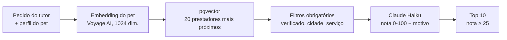

<div align="center">


# PetMatch

**Marketplace de serviços para pets que usa busca semântica e um LLM para encontrar o prestador certo para cada pet.**


[](https://github.com/giobroliatto/petmatch/actions/workflows/ci.yml)

</div>

[English](README.md) · **Português**


---

## O problema

Achar alguém de confiança para dar banho, passear ou cuidar do seu pet normalmente significa pedir indicação em grupo de WhatsApp. Os marketplaces genéricos filtram por categoria e cidade, mas não sabem que seu cachorro fica ansioso com estranhos, que sua gata tem 14 anos e toma remédio, ou que você prefere alguém que atenda em casa.

## A solução

No PetMatch, o tutor descreve o que precisa em linguagem natural, por exemplo *"alguém paciente para passear com meu cachorro idoso, ele puxa a guia"*. A busca combina o perfil do pet, o pedido e o perfil de cada prestador para devolver uma lista ordenada, com uma explicação curta de por que cada prestador combina.

Daí em diante, o ciclo inteiro do serviço acontece dentro do app: reserva, chat por reserva, briefing gerado por IA para o prestador, lembretes e avaliação no final.

## Como funciona

1. **Tutores** cadastram seus pets (espécie, raça, idade, peso, observações e ficha de saúde com lembretes de vencimento).
2. **Prestadores** montam o perfil com serviços, preços, disponibilidade semanal, galeria de fotos e um documento de identidade para verificação.
3. Um **administrador** analisa o documento e aprova o prestador. Só prestadores verificados aparecem nas buscas.
4. O tutor busca, reserva um serviço e conversa com o prestador no chat da reserva.
5. O prestador confirma ou recusa a reserva. E-mails de confirmação e lembretes 24 horas e 2 horas antes do serviço saem automaticamente.
6. Depois do serviço, o tutor deixa uma avaliação, que volta para o perfil do prestador.

<table>
<tr>
<td width="50%"><p align="center"><sub>Painel do tutor</sub></p></td>
<td width="50%"><p align="center"><sub>Painel do prestador, com solicitações pendentes e tags de qualidade geradas por IA</sub></p></td>
</tr>
</table>

## Funcionalidades de IA

### Matching: busca vetorial + reordenação com LLM



- Os **embeddings** de pets e prestadores são gerados com a **Voyage AI** e guardados numa coluna `vector(1024)` no PostgreSQL. Eles são criados **de forma assíncrona** por uma fila do BullMQ sempre que o perfil de um pet ou prestador muda.
- A busca ordena os prestadores por distância vetorial com o **pgvector** (`<=>`) e depois aplica os filtros obrigatórios (verificado, cidade, tipo de serviço).
- O **Claude Haiku** reordena os candidatos que sobraram. O prompt define regras explícitas de pontuação (oferecer o serviço pedido é decisivo, tags de qualidade que combinam e boas avaliações somam pontos) e pede um array JSON com nota e motivo em português para cada prestador.
- **Cada etapa tem um plano B:** sem embedding → busca tradicional por cidade e avaliação; busca vetorial vazia → busca tradicional; falha no LLM → ordenação por avaliação com um motivo genérico. A busca nunca quebra porque um provedor de IA caiu.

### Briefing pré-serviço

Quando uma reserva é criada, o Claude transforma os dados do pet e as observações do tutor num briefing curto e estruturado para o prestador (informações essenciais, cuidados especiais, observações do tutor). Se a geração falhar, a reserva é criada sem ele.

### Tags de qualidade a partir das avaliações

Cada nova avaliação dispara um job em segundo plano em que o Claude lê as avaliações do prestador e extrai até seis tags de qualidade, como *"pontual"* ou *"ótimo com pets ansiosos"*. As tags aparecem no perfil e são usadas pelo matching.

## Funcionalidades

| Perfil | O que pode fazer |
|---|---|
| Tutor | Gerenciar pets e ficha de saúde, busca com IA, reservar serviços, chat, cancelar, avaliar |
| Prestador | Perfil, serviços e preços, disponibilidade semanal, galeria, verificação, confirmar/recusar/concluir reservas, chat |
| Administrador | Estatísticas da plataforma, aprovar ou recusar verificações, suspender usuários, diagnóstico das integrações |

## Destaques técnicos

- **Monorepo com pnpm**: `apps/web` (Next.js) e `apps/api` (Fastify), além de um pacote `packages/shared` para schemas Zod e tipos.
- **Jobs em segundo plano com BullMQ:** embeddings, análise de avaliações e e-mails transacionais (incluindo os lembretes agendados de 24h e 2h) rodam fora do ciclo da requisição.
- **Degradação controlada:** cada integração externa (Voyage, Anthropic, Cloudflare R2, Resend) é opcional em desenvolvimento, e a página de diagnóstico do admin mostra quais estão configuradas.
- **Segurança:** autenticação JWT na API, proteção de rotas por papel no front (proxy do Next.js), rate limiting por rota com Redis, e uploads validados pelo conteúdo real do arquivo (magic bytes), não só pela extensão.
- **Autenticação:** e-mail e senha ou login com Google via Auth.js (NextAuth v5), além de redefinição de senha por e-mail.
- **Teste de e-mails local** com Mailpit: todo e-mail que o app envia pode ser visto em `localhost:8025`.
- **CI a cada push** com GitHub Actions: checagem de tipos, lint e build de produção dos dois apps.

## Stack

| Camada | Tecnologias |
|---|---|
| Front-end | Next.js 16 (App Router), React 19, Tailwind CSS 4, shadcn/ui, TanStack Query, React Hook Form, Zod, Auth.js |
| API | Node.js, Fastify 5, Prisma, Zod, JWT, bcrypt |
| Dados | PostgreSQL 16 + pgvector, Redis |
| IA | Claude Haiku (SDK da Anthropic), embeddings da Voyage AI |
| Jobs e e-mail | BullMQ, Resend (produção), Nodemailer + Mailpit (desenvolvimento) |
| Armazenamento | Cloudflare R2 (compatível com S3) |

## Rodando localmente

Pré-requisitos: Node.js 20+, pnpm 9+ e Docker.

```bash
git clone https://github.com/giobroliatto/petmatch.git
cd petmatch
pnpm install

# PostgreSQL com pgvector, Redis e Mailpit
pnpm docker:up

# Variáveis de ambiente
cp .env.example apps/api/.env
cp .env.example apps/web/.env.local

# Banco de dados
pnpm db:migrate
pnpm --filter api seed

# Web em http://localhost:3000, API em http://localhost:3001
pnpm dev
```

O seed cria três contas:

| Papel | E-mail | Senha |
|---|---|---|
| Administrador | `admin@petmatch.dev` | `Admin123!` |
| Prestador | `provider@petmatch.dev` | `Prov123!` |
| Tutor | `tutor@petmatch.dev` | `Tutor123!` |

A busca com IA precisa de `VOYAGE_API_KEY` e `ANTHROPIC_API_KEY`. Sem elas, o app cai na busca tradicional e pula os briefings e as tags das avaliações. Os uploads precisam das variáveis `R2_*`. A lista completa está no [`.env.example`](.env.example).

## Estrutura

```
apps/
├── web/                   # Next.js
│   ├── app/               # Rotas por papel: (auth), (tutor), (provider), (public), admin
│   ├── components/        # UI (shadcn), reservas, pets, busca, layout
│   └── lib/               # Hooks da API (TanStack Query), auth, helpers
└── api/                   # Fastify
    ├── prisma/            # Schema, migrations e seed
    └── src/
        ├── modules/       # auth, pets, providers, services, availability,
        │                  # bookings, messages, reviews, admin, ai
        ├── lib/           # Prisma, Redis, Anthropic, R2, e-mail, validação de arquivos
        └── plugins/       # Autenticação JWT
packages/
└── shared/                # Schemas Zod e tipos
```

## Próximos passos

- Testes automatizados (unitários e end-to-end)
- Deploy (a API e os workers precisam de um host com Redis, e o banco precisa de pgvector)
- Chat em tempo real (hoje as mensagens são buscadas periodicamente)
- Pagamentos

---

## Autor

Feito por **Giovani Broliatto**.

[](https://www.linkedin.com/in/giobroliatto/)
